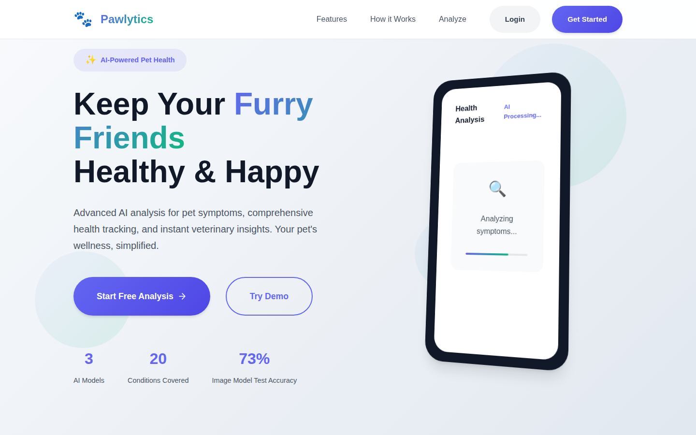
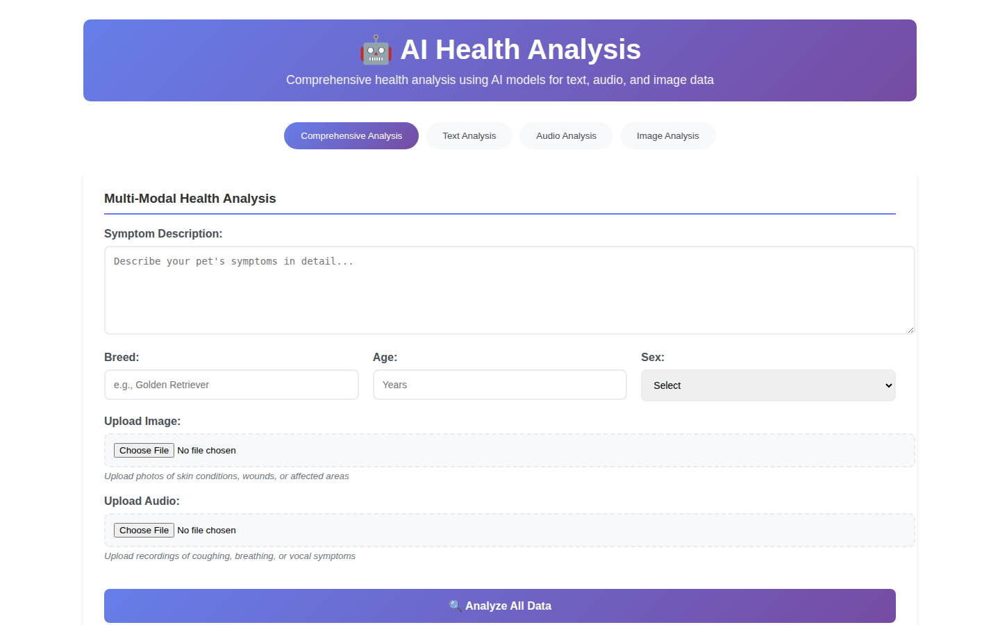
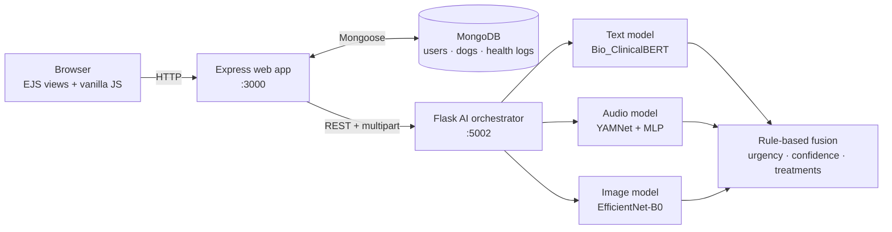

<div align="center">

# 🐾 Pawlytics

### A multimodal AI assistant for early detection of dog health conditions

Describe the symptoms, upload a photo of the affected area, or record the sound your dog is making —
Pawlytics runs **three deep-learning models** and combines them into a single report with a likely
condition, an urgency level and suggested next steps.


*Graduation project · Ziad Elhussein*

</div>

<p align="center">
  
</p>

> **Not a veterinarian.** Pawlytics is an academic prototype. Its predictions are
> decision *support*, not a diagnosis — see [Limitations](#limitations--responsible-use).

---

## Table of contents

- [What it does](#what-it-does)
- [Architecture](#architecture)
- [The three models](#the-three-models)
- [Tech stack](#tech-stack)
- [Getting started](#getting-started)
- [API overview](#api-overview)
- [Repository layout](#repository-layout)
- [Datasets](#datasets)
- [Limitations & responsible use](#limitations--responsible-use)
- [Author](#author)

## What it does

| | |
|---|---|
| 🧠 **Symptom analysis (text)** | Free-text symptoms + breed, age and sex → one of 20 common canine conditions, with a severity estimate and treatment suggestions. |
| 🔊 **Sound analysis (audio)** | A short recording of coughing, breathing, whining, etc. → kennel cough, reverse sneeze, tracheal collapse, or normal sounds. |
| 📷 **Photo analysis (image)** | A photo of skin, eyes or nose → one of 9 visual conditions (mange, fleas, dermatitis, fungal / bacterial infection …) or *healthy*, with a medical-protocol lookup. |
| 🧾 **Combined report** | The orchestrator merges every modality that was supplied into one report: primary diagnoses, confidence, overall urgency, emergency flags and de-duplicated treatment recommendations. |
| 🐕 **Pet health tracking** | Accounts, dog profiles, medical history, vaccinations, medications and a dashboard of past analyses. |

<p align="center">
  
</p>

## Architecture



The web tier (Node.js) owns users, sessions, uploads and persistence. All machine learning lives in a
separate Python service so the models can be loaded once, scaled or swapped without touching the web app.
The fusion step is deliberately simple — thresholds and keyword rules rather than another learned model —
which keeps the final recommendation easy to inspect and explain.

## The three models

Numbers below are taken straight from the training notebooks in [`notebooks/`](notebooks/) and measured
on **held-out test data**. Full details, per-class results and caveats are in
[`docs/MODEL_CARDS.md`](docs/MODEL_CARDS.md).

| Modality | Architecture | Classes | Training data | Test result |
|---|---|---|---|---|
| **Text** | [Bio_ClinicalBERT](https://huggingface.co/emilyalsentzer/Bio_ClinicalBERT) + dropout / 256-unit head (PyTorch) | 20 conditions | ~52k owner-reported health records from the Dog Aging Project (split by dog to avoid leakage) | **63.8 %** accuracy (see caveat below) |
| **Audio** | Frozen [YAMNet](https://tfhub.dev/google/yamnet/1) embeddings (1024-d) + 3-layer MLP (TensorFlow) | 8 sound classes | 953 clips collected from online videos, 3 s @ 16 kHz | **71.9 %** accuracy · 0.71 macro-F1 |
| **Image** | EfficientNet-B0 (frozen ImageNet backbone) + trained classifier head, class-weighted and label-smoothed loss (PyTorch) | 9 skin / eye / nose conditions | ~24.8k images merged, de-duplicated and leak-checked from 20+ public datasets | **73.2 %** accuracy (1,752 test images) |

> **Reading these numbers honestly.** The text model's symptom sentences were *generated from the disease
> label* with rules (the source data has diagnoses, not free-text symptoms), so 63.8 % measures how well the
> model learns that mapping — not real-world clinical accuracy. A second experiment with noisier, more
> realistic text scored 42.2 %. The image model's 3-fold cross-validation score (94.1 %, measured on folds of
> the training split with a partly unfrozen backbone) is much higher than the held-out test accuracy of the
> final model (73.2 %, frozen backbone); the test score is the one to trust. See the model cards.

## Tech stack

| Layer | Technologies |
|---|---|
| **Frontend** | EJS templates, vanilla JavaScript, hand-written CSS |
| **Web backend** | Node.js, Express 5, Mongoose / MongoDB, `express-session` + `connect-mongo`, Multer, bcrypt, Helmet, `express-rate-limit`, `express-validator`, Nodemailer |
| **AI service** | Python, Flask, PyTorch, TensorFlow / Keras, TensorFlow Hub (YAMNet), Hugging Face Transformers, librosa, scikit-learn |
| **Training** | Jupyter notebooks on Kaggle (GPU), pandas, NumPy, Matplotlib / Seaborn |

Security basics in place: hashed passwords (bcrypt), enforced password complexity, session cookies
(`httpOnly`, `secure` in production), rate limiting on auth / API / uploads, Helmet security headers with a
CSP, input sanitisation, upload type and size limits, and per-user data access checks.

## Getting started

### Prerequisites

- **Node.js ≥ 20.6** and **npm**
- **Python ≥ 3.8**
- **MongoDB** running locally (or a connection string)
- **ffmpeg / ffprobe** on your `PATH` (used to read uploaded audio metadata)
- The **trained model weights** (see below)

### 1 · Get the model weights

The weights are too large for git. Download them from the project's
[Google Drive folder](https://drive.google.com/drive/folders/1U85lGQ92size64bowUVOEj2Vrd3BiUfc?usp=drive_link)
and place them where the inference code expects them:

```
app/textmodelW/model_assets/dog_disease_model.pth
app/textmodelW/model_assets/bio_clinical_bert/          # full Bio_ClinicalBERT weights
app/audiomodelW/audio_model_assets/dog_audio_model.h5
app/imagemodelW/model_assets/skin_disease_model.pth
```

Class lists, label encoders, tokenizer files and medical-protocol JSON are already in the repo.

### 2 · Configure

```bash
cd app
cp .env.example .env      # then edit: SESSION_SECRET, MONGO_URI, optional EMAIL_USER / EMAIL_PASS
```

### 3 · Run

**Windows (one click):** double-click `app/start_services.bat`.

**Manual (any OS):**

```bash
# terminal 1 — AI service on :5002
cd app/ai_service
pip install -r requirements.txt
python start_ai_service.py

# terminal 2 — web app on :3000
cd app
npm install
npm run start:env          # loads .env; or: npm start
```

Open <http://localhost:3000>, create an account, and try **AI Analysis**.
Sample inputs to try are in [`app/samples/`](app/samples/).

> Without the model weights the web app still runs (auth, dog profiles, dashboard), but the AI service
> will refuse to start.

## API overview

**AI service (Flask, `:5002`)**

| Method | Endpoint | Purpose |
|---|---|---|
| `GET`  | `/health` | Service + model status |
| `POST` | `/analyze/text` | `symptom_text`, optional `breed`, `age`, `sex` |
| `POST` | `/analyze/audio` | audio file |
| `POST` | `/analyze/image` | image file, optional symptom text |
| `POST` | `/analyze/comprehensive` | any combination of the above → combined report |

**Web app (Express, `:3000`)** — proxies the above under `/api/ai/*` and adds auth (`/signup`, `/login`,
`/logout`), dog CRUD with medical history / vaccinations / medications (`/api/dogs…`), and health-log
analysis and statistics (`/api/health/…`).

## Repository layout

```
pawlytics/
├── app/                      # the application
│   ├── app.js                # Express entry point
│   ├── routes/               # auth, dogs, health logs, AI proxy, mailer
│   ├── models/               # Mongoose schemas (User, Dog, HealthLog)
│   ├── middleware/           # security headers, rate limits, sanitising
│   ├── views/  public/       # EJS pages, scripts and styles
│   ├── ai_service/           # Flask orchestrator that combines the three models
│   ├── textmodelW/           # text-model inference code + class / treatment metadata
│   ├── audiomodelW/          # audio-model inference code + class metadata
│   ├── imagemodelW/          # image-model inference code + medical protocols
│   ├── samples/              # example photos and sounds for quick testing
│   └── .env.example
├── notebooks/                # how every model was built
│   ├── text-model/           # data prep → symptom text → Bio_ClinicalBERT training
│   ├── audio-model/          # dataset collection → YAMNet classifier
│   └── image-model/          # cleaning → merging → EfficientNet-B0 training
└── docs/
    ├── MODEL_CARDS.md        # data, training, metrics and limitations per model
    └── screenshots/
```

## Datasets

The datasets were assembled for this project and published on Kaggle:

- 🔊 Audio — <https://www.kaggle.com/datasets/ziadelhussein/dog-disease-sound-dataset/data>
- 📝 Text — <https://www.kaggle.com/datasets/ziadelhussein/dapdatasetnew/data>
- 📷 Image — <https://www.kaggle.com/datasets/ziadelhussein/imagedataset/data>

Additional large files are in the [Google Drive folder](https://drive.google.com/drive/folders/1U85lGQ92size64bowUVOEj2Vrd3BiUfc?usp=drive_link).
The text data originates from the Dog Aging Project; the image and audio data were gathered from public
online sources. Please check each source's licence before redistributing.

## Limitations & responsible use

- **Not medical advice.** Predictions are probabilistic and can be wrong. Always consult a veterinarian —
  and seek urgent care immediately for emergencies (collapse, difficulty breathing, bleeding, seizures,
  suspected poisoning).
- **Small / uneven classes.** Some classes are rare (e.g. only ~200 training images of fleas; 62 clips of
  normal breathing), which limits per-class reliability.
- **Text model trained on generated symptom text** — see the note under [The three models](#the-three-models).
- **Domain shift.** Images and audio from different cameras, microphones and breeds than the training data
  will perform worse than the headline numbers.
- **Prototype security.** Good baseline protections are in place, but the app has not been
  penetration-tested; do not expose it publicly with real user data as-is.

## Author

**Ziad Elhussein** — AI / ML engineer · Cairo, Egypt (remote-friendly)
[GitHub](https://github.com/ziadelh)

If you find the project interesting, a ⭐ is always appreciated.
